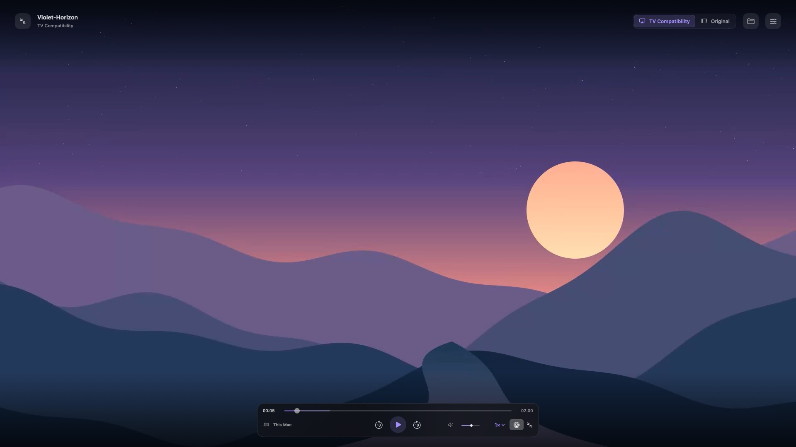
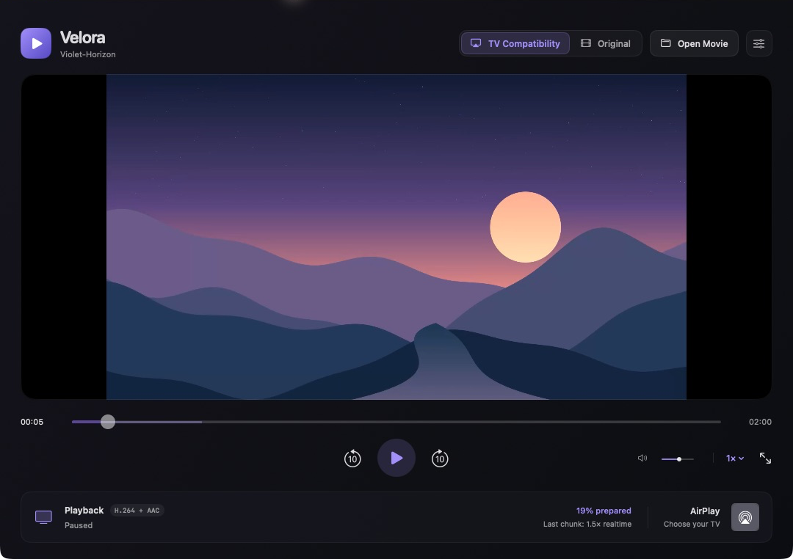
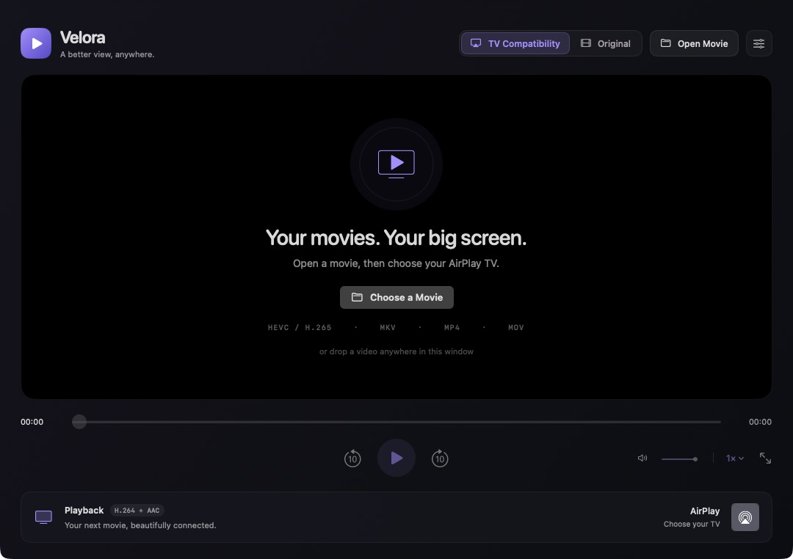

# Velora

**A native Mac video player that prepares HEVC movies for your AirPlay TV.**

Open a movie, choose your TV, and watch. Velora converts video into H.264 and AAC as it is needed, with a seekable timeline and a compact fullscreen interface.

[Download v0.2.2](https://github.com/othnielvtf/velora/releases/tag/v0.2.2) · [Report a problem](https://github.com/othnielvtf/velora/issues)



> **Early preview:** local HEVC playback and streaming have been tested. Physical Samsung, LG and Hisense AirPlay receivers still need testing; compatibility and seek latency vary by TV and source. The downloadable app is ad hoc signed, **not Developer ID signed or notarized**.

## What changed in v0.2.2

This release improves playback, seeking and cleanup after several rounds of code audits and regression testing.

- **Smoother audio through seeks:** continuous AAC encoding and a shared timing grid keep audio chunks aligned, including when the player reuses chunks from earlier seeks. Audio conversion pauses after a bounded lookahead.
- **Reliable movie endings and timestamps:** the timeline follows playable video, excluding audio padding and container timestamp offsets. NTSC, variable frame rate and long held frames keep their final picture. Original and TV Compatibility modes retain the same scene when switching.
- **Track choices stay explicit:** unsupported native audio/subtitle choices pause playback with guidance. Native playback commands respect that pause, and choosing a playable track clears it. Selected tracks and Pause remain intact through mode changes and pending seeks.
- **Bounded subtitle preparation:** at most two subtitle tracks are extracted at once. Abandoned requests cancel their scans; completed text tracks are cached across movie sessions, up to 256 MB.
- **Cleaner cancellation and quitting:** shared chunk requests retain work needed by other clients. Partial conversions are removed, timeouts stop stalled processes, and quitting waits for active and suspended media workers to exit.
- **More reliable local streaming:** idle connections have deadlines and separate capacity from active playback requests. Anamorphic video keeps its display aspect ratio, and quality changes leave Original playback in place.

All **79 regression tests** pass, together with the real HTTP/AVPlayer playback and audio/subtitle integration checks. A follow-up audit found no further actionable issues in the reviewed paths. Physical AirPlay receiver testing is still pending. See [verification details](VERIFICATION.md) and the [changelog](CHANGELOG.md).

## Features

- **HEVC / H.265 playback**, including MKV, MP4 and MOV through TV Compatibility mode.
- **Native AirPlay picker** for compatible TVs on your local network.
- **On-demand conversion** using Apple's VideoToolbox H.264 hardware encoder.
- **Seek anywhere:** four-second chunks are prepared independently, without converting all earlier video first.
- **Clean fullscreen controls** that fade during playback and return with mouse or keyboard activity.
- **Multiple audio tracks:** choose your language from the Audio & Subtitles menu.
- **Embedded text subtitles** and external SRT, VTT, ASS or SSA files, with language switching and Off.
- Timeline scrubbing, ten-second skips, slim volume control and playback speed selection.
- 1080p or 720p compatibility streams, plus an Original mode for formats supported by macOS.
- Local conversion and playback; no account or cloud service required.

## Screenshots

### Windowed playback



### Ready to play



Screenshots show the actual app. The landscape is original artwork rendered into an HEVC demo clip; no movie is included in the download.

## Requirements

- Apple silicon Mac (M1 or later).
- macOS 14 Sonoma or later. The release was tested on macOS 26; earlier supported versions need testing.
- An AirPlay-capable TV for TV playback, on the same local network as your Mac.
- Enough free disk space for the temporary audio/video cache (up to 2 GB per movie), plus a shared text-subtitle cache capped at 256 MB.

Intel Macs are not supported by this release.

## Install

1. Download **Velora-0.2.2-macOS-arm64.zip** from [Releases](https://github.com/othnielvtf/velora/releases/tag/v0.2.2).
2. Unzip it and move **Velora.app** to Applications.
3. Open the app. Because this preview is not notarized, macOS may block the first launch. If you trust this download, use **System Settings → Privacy & Security → Open Anyway**, then confirm the per-app prompt. See [Apple's guidance](https://support.apple.com/en-us/102445).

FFmpeg and FFprobe are included. No Homebrew or separate codec installation is needed.

## Watch on your TV

1. Leave **TV Compatibility** selected.
2. Click **Open Movie**, press **⌘O**, or drop a video onto the window.
3. Wait for the first chunk to prepare, then use the **AirPlay** button to choose your TV.
4. Allow Local Network access and incoming connections if macOS asks.

The Mac must remain awake and connected while watching. Seeking to an uncached position can briefly buffer; Velora does not promise instant seeking or zero startup delay. AirPlay receiver buffering adds its own delay.

Use the settings button to choose stream quality or a LAN interface. If the TV appears but playback fails, check the macOS firewall, Local Network permission, VPN routing and guest Wi-Fi isolation. The TV must be able to reach the Mac.

## Controls

| Action | Shortcut |
| --- | --- |
| Open a movie | ⌘O |
| Load external subtitles | ⇧⌘O |
| Play / pause | Space |
| Back / forward ten seconds | ⌘← / ⌘→ |
| Back / forward in fullscreen | ← / → |
| Toggle fullscreen | ⌃⌘F or double-click the video |
| Exit fullscreen | Esc |
| Close the movie | ⇧⌘W |

## How it works

**TV Compatibility** creates a local HLS stream with independently encoded four-second H.264 video chunks, up to 1080p30 at 6 Mbps or 720p30 at 3 Mbps. Smaller sources are not enlarged, and anamorphic sources retain their display aspect ratio. Stereo AAC is encoded continuously across adjacent chunks to avoid repeated encoder priming. Audio preparation pauses after a small lookahead; distant seeks use bounded preroll on a shared audio timing grid so chunks from different seek histories still join correctly. The complete VOD timeline is available immediately; requested chunks are generated on demand and cached.

The native AVPlayer handles playback and AirPlay. Velora uses Apple's receiver picker rather than implementing the AirPlay protocol itself. A token-scoped local HTTP server serves only the active movie's playlists and converted chunks. It does not expose the original file or arbitrary folders. Closing a movie stops its server, cancels conversion and removes its audio/video cache. Converted text subtitles are retained in a separate local cache capped at 256 MB, keyed to the source file and track so later sessions can reuse them. The original file is never changed.

**Original** plays the original file with macOS's native format support. HEVC in a supported MP4/MOV may play directly; MKV and unsupported audio often need TV Compatibility. Direct AirPlay depends on the source and receiver.

## Audio and subtitles

Click the **caption bubble** beside the playback-speed control. The same **Audio & Subtitles** menu is available in fullscreen.

- **Audio:** select a language or named track. Original mode marks native tracks that require TV Compatibility and pauses unsupported selections with guidance, including when native controls request playback. Choosing a playable track clears the block. TV Compatibility converts the selected track to stereo AAC. Switching audio briefly rebuilds the stream while retaining the movie position, paused/playing state and subtitle choice. Original mode uses native macOS audio-track selection.
- **Subtitles:** select a language, accessibility (SDH) track or **Off**. Embedded SubRip/SRT, ASS/SSA, WebVTT and MP4 timed text are supported in TV Compatibility. Native Original mode offers the subtitle tracks exposed by macOS.
- **External files:** choose **Load Subtitle File…**, press **⇧⌘O**, or drop an SRT/VTT/ASS/SSA file onto an open movie. Importing or replacing a sidecar uses TV Compatibility and retains playback position. Remove it from the same menu.
- Text subtitles travel as optional WebVTT renditions alongside the local HLS video, including over AirPlay. Switching subtitles does not re-encode the picture. Preparing an embedded track for the first time scans the movie; the timeout scales with file size and the result is reused across sessions. At most two tracks are prepared at once, and scans stop when no requesting client needs them. TV subtitle rendering still needs physical receiver testing.
- Captions move above the floating fullscreen controls while those controls are visible. Their normal placement returns when the controls fade.

ASS/SSA is converted to basic text and supported inline formatting; custom fonts, complex positioning, animations and karaoke styling are not preserved. PGS, VobSub/DVD and other image-based subtitle tracks need an external text subtitle file in TV Compatibility. External files should use UTF-8. A subtitle language selected while paused may refresh visually when playback resumes. Select tracks from the Mac; this version does not advertise alternate audio languages to the TV's own audio menu.

## Current limitations

- Physical AirPlay TV testing is pending. Please include your TV model and firmware when reporting results.
- No image-based subtitle conversion, multichannel audio passthrough, Dolby Vision preservation or HDR output in compatibility mode.
- Tagged PQ/HLG sources have an SDR tone-mapping path, which needs more real-source validation.
- Speed controls depend on receiver support. There is no trick-play preview track.
- Conversion speed, startup and seeking depend on source complexity, Mac hardware, Wi-Fi and the receiver.
- The first non-cover-art video track is used. One selected audio track is streamed at a time.

**Copy Diagnostics** includes the movie filename and local network address. Review it before posting an issue; stream access tokens are omitted. For implementation checks and measured local results, see [VERIFICATION.md](VERIFICATION.md).

## Build from source

Install Xcode or its Command Line Tools with **Swift 6 or later**, then:

```sh
git clone https://github.com/othnielvtf/velora.git
cd velora
./scripts/build.sh
open dist/Velora.app
```

The first build downloads checksum-pinned FFmpeg 9.0.2 and zimg 3.0.6 sources and compiles the tools locally. This takes several minutes and requires Internet access. It uses Xcode's compiler, `/usr/bin/python3` (3.9+) and system build tools, without installing global dependencies. Upstream source archives are kept in `.build/media-tools/archives`.

The script creates an ad hoc signed bundle in `dist/Velora.app`. Quit the app before rebuilding over it. Set `VELORA_APP_PATH`, `VELORA_BUILD_DIR` or `VELORA_TOOLS_BUILD_DIR` to choose other output directories. You can also open `Package.swift` in Xcode after building the media tools.

### Verification

```sh
swift test
swift run VeloraCheck \
  --tools "$PWD/Resources/Tools" \
  --input "/absolute/path/to/movie.mkv" \
  --report "/absolute/path/to/report.json"
```

The integration check exercises the real HTTP stream, H.264/AAC output, duplicate requests, byte ranges, token isolation, AVPlayer duration, decoded frames and forward/backward seeks. It does not connect to a TV.

Run the track-selection check with a generated two-language fixture:

```sh
./scripts/verify-tracks.sh
```

This checks the actual encoded audio tones, WebVTT delivery to AVPlayer, language switching, seeking, Off, external SRT/VTT/ASS conversion and subtitle URL isolation.

The regression suite also covers AAC waveform and packet continuity, video padding and timestamp offsets, held frames in variable-frame-rate files, shared-request cancellation, bounded subtitle extraction, server admission and disconnects, process timeouts, subtitle-cache reuse, and native player intent. Codec checks skip when the bundled tools have not been built. To include the optional native mode-switching check, set `VELORA_PLAYER_TEST_MOVIE` to a native MP4 with at least two audio languages before running `swift test`.

### Source layout

| Path | Purpose |
| --- | --- |
| `Sources/Velora` | SwiftUI interface, native controls and playback state |
| `Sources/VeloraCore` | Metadata, conversion, HLS chunks and LAN server |
| `Sources/VeloraCheck` | Local end-to-end verification executable |
| `Tests/VeloraCoreTests` | Timeline, HTTP and byte-range tests |
| `scripts` | App packaging, icon generation and media-tool builds |

## License

Velora is licensed under **GPL-3.0-or-later**. FFmpeg and zimg retain their own licenses and copyright notices. The release includes a corresponding-source archive for the bundled media tools and their build script. See [LICENSE](LICENSE) and [THIRD-PARTY-NOTICES.md](THIRD-PARTY-NOTICES.md).
